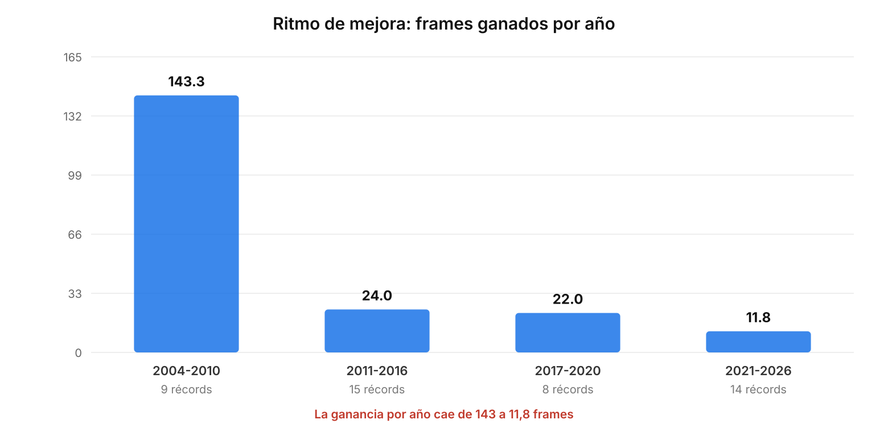
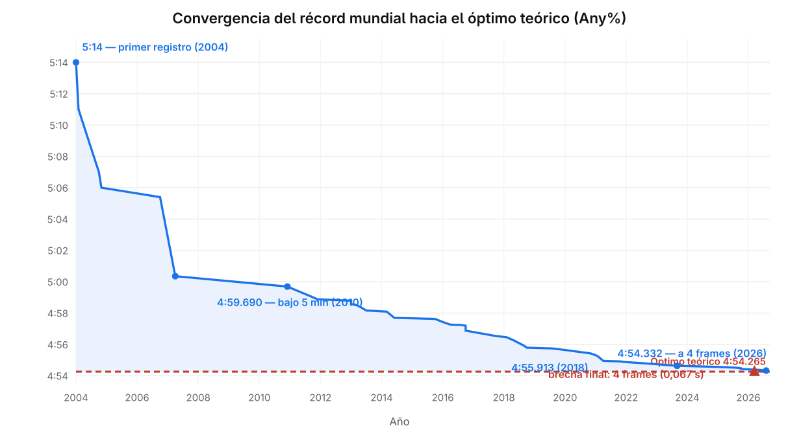
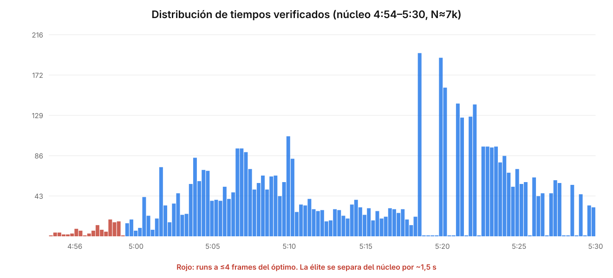
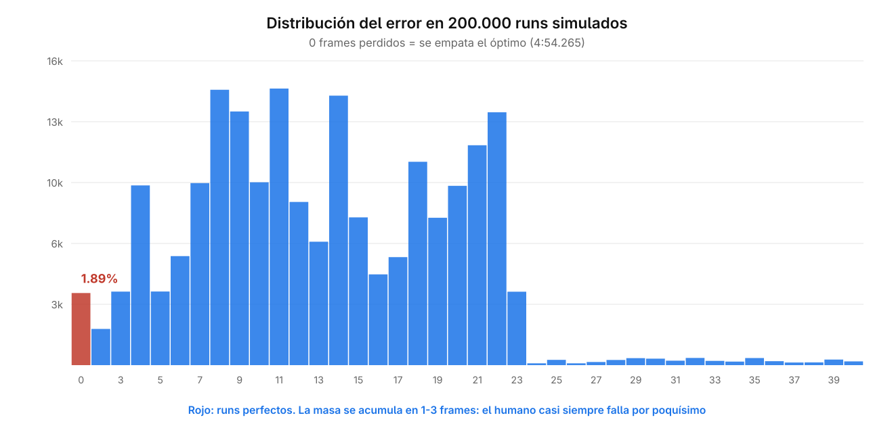
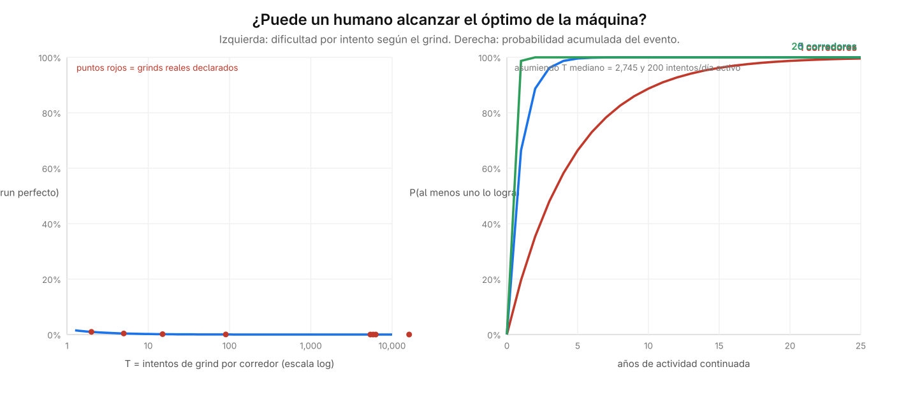

# El límite humano: ¿Puede el hombre alcanzar la perfección de la máquina?

**Estudio de caso: la categoría Any% de *Super Mario Bros.* (NES, 1985)**

Borrador de investigación — versión 0.2
Fecha de cierre de datos: 19 de octubre de 2026
(v0.2 corrige el denominador de la calibración probabilística; ver §5.3a)

Datos y código reproducibles: https://github.com/Josesepin3/limite-humano

---

## Resumen

> **Antes de empezar.** Este resumen y el capítulo 1 usan términos propios del
> *speedrunning* (como *Any%*, `8-4`, TAS o *frame rule*) que se explican por
> primera vez en §2.0 y §2.2-2.3, y que se recogen en el glosario del Anexo C.
> Un lector ajeno al tema puede leerlo en orden: el capítulo 2 está escrito
> precisamente para no dar nada por supuesto.

Esta investigación examina si un ser humano puede igualar el óptimo de ejecución que una máquina —un *tool-assisted speedrun* (TAS)[^10]— puede alcanzar en un videojuego, y qué factores determinan la brecha residual cuando la igualación no ocurre. Se toma como caso de estudio la categoría Any%[^11] de *Super Mario Bros.* para NES (1985), por ser uno de los pocos escenarios donde el límite superior de ejecución está cuantificado con precisión de *frame* y donde existe un corpus público, verificable y masivo de intentos humanos.

El análisis combina un corpus de **6.916 runs verificados** extraídos de la API pública de speedrun.com (6.752 de la versión NTSC[^12]) (speedrun.com, 2026a) con la **progresión histórica de 46 récords mundiales** documentada entre enero de 2004 y agosto de 2026, y con los **203 runs verificados del *leaderboard*[^13] dedicado al nivel 8-4** (speedrun.com, 2026b) (203 jugadores distintos). Al cierre de los datos, el récord humano se sitúa en **4:54.332** (Niftski, 2026), a **4 frames (0,067 s)** del óptimo teórico de **4:54.265** declarado por la comunidad (Maru, 2023). La brecha frente al óptimo se ha cerrado en un **99,66 %** desde el primer registro documentado.

Los resultados muestran que el avance no ha sido lineal: el ritmo de mejora cayó de **143 frames por año** (2004-2010) a **11,8 frames por año** (2021-2026), y que los últimos cuatro frames deberán ganarse en la única sección del recorrido sin *frame rule*, donde el error no se redondea. La prueba estructural es contundente: **los diez mejores runs de la historia no pierden ni un solo escalón de 21 frames**; todo su residuo vive en 8-4.

Sobre esa base se construyó un **sistema de simulación Monte Carlo calibrado con datos reales**. Una primera versión del sistema estimó una probabilidad de **1,89 % por intento**, pero el propio corpus obligó a corregirla: el *leaderboard* del 8-4 es un tablero de **mejores marcas personales** (speedrun.com, 2026b) (203 runs, 203 jugadores distintos, ninguno repetido), no un registro de intentos. Es decir, los 4 aciertos perfectos miden la probabilidad de que un corredor dedicado logre un PB perfecto, no la de acertar en un intento cualquiera. Los comentarios de los propios corredores confirman el error: sus marcas costaron entre 2 minutos y 32,5 meses de intentos.

Corregido el denominador mediante un modelo de renovación de dos niveles (`P(PB) = 1 − (1−p)^T`), la probabilidad por intento cae a **3,3 × 10⁻⁶** en el escenario central (mediana del *grind* observado, T = 6.075 intentos), lo que sitúa la mediana en **~219.000 intentos** para una probabilidad del 50 %. La consecuencia para la pregunta central es la siguiente: como *evento* aislado, la igualación es **estadísticamente esperable si la comunidad sostiene la actividad** (con 5 corredores activos, ~92 % en 5 años; con 20, prácticamente certeza); como *régimen* repetible, no lo es, porque el error por intento no mejora con el tiempo. El mismo modelo se validó por vía analítica cerrada, con una discrepancia de solo el 0,2 % en su componente mecánico.

**Conclusión preliminar:** la igualación es viable y estadísticamente esperable como *evento*, pero no como *régimen*. El humano no alcanza a la máquina por ser más lento, sino porque el residuo está en una fracción del recorrido donde no existe margen estructural para absorber el error, y porque solo puede intentarlo, no decidirlo. La precisión humana en la sección crítica es **estacionaria**: no mejora con el entrenamiento acumulado de la comunidad. Ese es el techo biológico.

---

## 1. Introducción

### 1.1 Planteamiento del problema

Desde 2010, la comunidad de *speedrunning* de *Super Mario Bros.* ha reducido su récord mundial en más de cinco segundos (Wikipedia, 2026). Lo notable no es la magnitud de la mejora, sino dónde ha terminado: en una diferencia de cuatro *frames* respecto del mejor tiempo que la comunidad considera humanamente alcanzable. Cuatro frames equivalen a 0,067 segundos, aproximadamente el tiempo que tarda un parpadeo en completarse a la mitad.

La pregunta que motiva esta investigación no es la del récord, sino la del límite. Un *tool-assisted speedrun* no juega: calcula. Introduce los inputs exactos, frame a frame, sin cansancio, sin temblor, sin latencia. Un humano juega: percibe, decide y ejecuta bajo restricciones biológicas que ningún entrenamiento elimina por completo. La prensa especializada ha cubierto cada uno de estos umbrales como hitos (Burns, 2018; Orland, 2021, 2023; Bailey, 2025; Colantonio, 2026). Cuando la diferencia entre ambos se reduce a cuatro frames, la pregunta deja de ser empírica y se vuelve estructural: **¿existe un piso que el humano no puede cruzar, o el récord vigente es simplemente el mejor intento hasta ahora?**

### 1.2 Justificación

El caso de *Super Mario Bros.* es inusualmente adecuado para estudiar esta pregunta por tres razones:

1. **El límite superior está cuantificado.** Para este juego existe un óptimo teórico declarado —4:54.265— construido sobre el mejor TAS conocido (Maru, 2023) y sobre la restricción de que un humano no puede pulsar izquierda y derecha simultáneamente[^14]. No se discute un techo abstracto: se discute un número concreto.

2. **El tiempo es discreto y verificable.** La consola procesa la lógica 60,0988138974405 veces por segundo (NTSC). El error humano se mide en frames enteros, no en impresiones. Todo run de élite es verificado por moderadores y conserva el archivo de inputs, lo que permite reproducirlo y auditar dónde se perdió cada frame.

3. **El corpus es masivo y público.** Existen miles de runs verificados y documentación periodística e interna de casi dos décadas (Colantonio, 2026; Orland, 2021, 2023). Esto permite estudiar la distribución completa de intentos y no solo el extremo superior.

El resultado trasciende el videojuego. Es un caso de laboratorio natural sobre la relación entre una tarea humana y su óptimo algorítmico, medible con una resolución que pocos dominios permiten.

### 1.3 Pregunta de investigación

> **¿En qué medida y bajo qué condiciones puede un ser humano igualar el óptimo teórico de ejecución en la categoría Any% de *Super Mario Bros.* (NES, versión NTSC), y qué factores explican la brecha residual?**

### 1.4 Objetivos

**Objetivo general**

Analizar la posibilidad de que un ser humano iguale el óptimo teórico de ejecución en la categoría Any% de *Super Mario Bros.* (NES, NTSC), mediante el análisis comparativo de runs verificados y de la progresión histórica del récord mundial.

**Objetivos específicos**

1. **Identificar** el estado del arte del límite humano y del óptimo teórico en la categoría y versión seleccionadas.
2. **Describir** la distribución temporal de los tiempos verificados y su evolución entre 2004 y 2026.
3. **Identificar** los puntos del recorrido donde la ejecución humana pierde más tiempo respecto del óptimo.
4. **Analizar** la relación entre el volumen de intentos y la reducción de la brecha a lo largo del tiempo.
5. **Analizar** los límites físicos y lógicos de la ejecución humana como marco explicativo de la brecha residual.

### 1.5 Hipótesis

- **H1.** La brecha entre el récord humano y el óptimo teórico ha seguido una tendencia decreciente pero desacelerada, compatible con una asíntota distinta de cero.
- **H2.** La brecha residual se concentra en la sección final (8-4), la única sin *frame rule*, donde el error humano no puede ser absorbido por el redondeo de la transición de nivel.
- **H3.** El límite de la igualación no es la velocidad del humano, sino su consistencia: la probabilidad de encadenar todas las decisiones críticas sin error.

---

## 2. Marco teórico

> **Convención de lectura.** Los conceptos que un lector ajeno al medio puede
> necesitar se explican en notas al pie[^1] la primera vez que aparecen, para no
> interrumpir el hilo del argumento. El glosario completo está en el Anexo C.

### 2.0 El objeto de estudio, desde cero

Esta investigación trata sobre un videojuego concreto y una forma concreta de
jugarlo. Conviene fijar ambos antes de entrar en el problema.

**El juego.** *Super Mario Bros.* es un videojuego de plataformas publicado por
Nintendo en 1985 para la consola *Nintendo Entertainment System* (NES). El
jugador controla a un personaje, Mario, que debe atravesar una serie de niveles
desplazándose de izquierda a derecha, saltando obstáculos y esquivando enemigos.
Cada nivel comienza en un punto fijo y termina en un punto fijo. El objetivo
final es derrotar al antagonista, Bowser, y completar el juego.

**Los niveles.** El juego tiene 32 niveles, agrupados en **ocho mundos** de
cuatro niveles cada uno. Se nombran con dos números: el mundo y el nivel dentro
de él. Así, `1-1` es el primer nivel del primer mundo; `8-4` es el cuarto y
último nivel del octavo y último mundo[^2]. Esta nomenclatura es la que usa toda
la comunidad y la que aparece a lo largo del documento.

**La categoría.** En el *speedrunning* se compite dentro de **categorías**: no
se trata solo de terminar el juego rápido, sino bajo un conjunto de reglas
acordado. La categoría que estudia esta investigación es **Any%** (se lee
«any percent», «cualquier porcentaje»): se trata de llegar al final del juego lo
más rápido posible **sin importar cuánto contenido se haya completado**. Bajo
esta regla, el jugador puede —y debe— saltarse mundos enteros usando atajos
llamados *warps*[^3]. Eso reduce el recorrido de 32 niveles a solo ocho, en un
orden concreto: `1-1, 1-2, 4-1, 4-2, 8-1, 8-2, 8-3` y, finalmente, `8-4`.

**Por qué el recorrido importa para este estudio.** De esos ocho niveles, los
**siete primeros** están sujetos a una regla de temporización que amortigua el
error humano; el octavo, `8-4`, **no lo está** (§2.3). Esa asimetría es el
hallazgo central del trabajo: toda la dificultad residual se concentra en un
único nivel. Buena parte de este documento consiste, en el fondo, en explicar
por qué esos siete niveles *perdonan* y ese uno *no*.

**El nivel 8-4.** Es el castillo final. A diferencia del resto del juego, casi
nunca se avanza en línea recta: es un laberinto de salas conectadas por
tuberías, y para salir hay que entrar en ellas **en el orden correcto**. Un
error de elección devuelve al jugador a una sala ya vista, en un bucle sin
salida. El nivel termina en una sala con Bowser, al que hay que derrotar —o
esquivar— para alcanzar el hacha que completa el juego.

Sus dos rasgos definen el problema por razones opuestas:

- **Es un laberinto y es largo.** Eso lo hace más propenso al error que
  cualquier otro nivel del recorrido.
- **Es el último nivel y no tiene transición posterior.** Eso lo excluye del
  mecanismo que, en los otros siete, absorbe el error humano (§2.3).

La combinación es lo que convierte a `8-4` en el lugar donde vive toda la
brecha residual. Como se verá en §5.3a, cuando se corre **solo este nivel** en
condiciones ideales, un humano tarda 44,227 segundos (2.658 frames): un único
error de un solo frame arruina el intento completo, y no hay redondeo que lo
disimule.

### 2.1 Speedrunning y TAS

Un *speedrun* es un intento de completar un videojuego en el menor tiempo posible bajo un conjunto de reglas explícitas. Un *tool-assisted speedrun* (TAS) es la construcción de una secuencia de inputs[^4] óptima mediante herramientas de emulación que permiten avanzar y retroceder frame a frame, guardar estados y ensayar sin costo temporal.

La distinción crucial para esta investigación es que un TAS **no es un récord humano**. No compite en la misma tabla de clasificación, salvo en categorías explícitamente separadas. Su función es doble: entretener (mostrar ejecuciones imposibles) y **establecer el techo** (demostrar que un tiempo dado es alcanzable). El valor "humanly possible" de un TAS es precisamente lo que esta investigación usa como referencia.

### 2.2 La unidad de medida: el frame

La NES NTSC ejecuta su lógica a **60,0988138974405 Hz**. Cada ciclo completo es un *frame*[^5], aproximadamente 16,64 milisegundos. La consola lee los inputs del mando una vez por frame. Esto significa que el tiempo de juego es fundamentalmente discreto: no existe una mejora de "medio frame".

Para dimensionarlo: un parpadeo humano dura unos 100 milisegundos, es decir, unos **seis frames**. Toda la brecha que separa al récord humano del óptimo teórico —cuatro frames— cabe dentro de la mitad de un parpadeo.

La conversión utilizada en todo el documento es:

```
segundos_por_frame = 1 / 60,0988138974405 ≈ 0,016639 s
```

### 2.3 El frame rule

*Super Mario Bros.* impone una restricción estructural decisiva: la transición entre niveles no ocurre de inmediato, sino que espera a que el contador de frames transcurridos desde el inicio del nivel sea múltiplo de **21**. Este es el *frame rule*[^6].

Su consecuencia es contraintuitiva: un jugador puede ejecutar un nivel de forma **subóptima** y aun así obtener el mismo tiempo que un TAS óptimo, siempre que su error no sea lo bastante grande para cruzar el siguiente múltiplo de 21. El frame rule actúa como un amortiguador que **absorbe el error humano**.

Para verlo con una imagen: imagínese una fila de escalones[^7] separados por 21 frames. Mientras el jugador se mantenga dentro del escalón en el que empezó, sube al siguiente en el mismo instante que lo haría la máquina: el tiempo no cambia. Solo si el error acumulado es tan grande que lo empuja **al escalón siguiente** paga la penalización completa de 21 frames. No importa haber perdido 3, 10 o 20 frames: mientras no se cruce el escalón, el cronómetro no lo nota.

Formalmente, si un nivel óptimo se completa en `F` frames, el humano obtiene el mismo tiempo si completa en `F, F+1, ..., F+(21-1)` frames según el residuo respecto del múltiplo de 21. El colchón es de hasta 20 frames, equivalentes a **0,3494 segundos**.

**La excepción es 8-4.** Al ser el último nivel, no hay transición posterior que redondee: cada frame cuenta. Por eso la brecha residual de 4 frames se concentra necesariamente allí.

> **En una frase.** En siete de los ocho niveles, el error humano se redondea y no cuesta tiempo. En el octavo, `8-4`, cada frame perdido se paga íntegro. Toda la dificultad del récord mundial vive en esa diferencia.

### 2.4 Comportamiento humano bajo presión temporal

La literatura sobre tareas psicomotoras bajo restricción temporal sostiene que la variabilidad del tiempo de reacción humano tiene un componente irreducible: incluso un experto, bajo condiciones ideales, presenta una dispersión de milisegundos. Aplicada a un sistema discreto, esta variabilidad se traduce en una tasa de acierto por decisión inferior a la unidad, que se compone multiplicativamente a lo largo de una tarea secuencial (véase el modelo del capítulo 5).

### 2.5 Definiciones operacionales

| Término | Definición operacional en este estudio |
|---|---|
| **Run** | Una partida completa, desde el inicio hasta el final, ejecutada de una sola vez. |
| **RTA** | *Real-time attack*: run ejecutado por un humano en tiempo real, verificado por moderación. |
| **TAS** | Secuencia de inputs generada con herramientas de emulación; no ejecutada por un humano. |
| **Any%** | Categoría que consiste en terminar el juego lo más rápido posible, sin exigir completar todo su contenido. |
| **IL** | *Individual level*: categoría en la que se corre **un solo nivel** en lugar del juego completo[^8]. |
| **Óptimo teórico** | Mejor tiempo humanamente alcanzable declarado por la comunidad: **4:54.265**. |
| **Brecha** | Diferencia entre el récord humano vigente y el óptimo teórico. |
| **Frame** | Unidad temporal de la NES NTSC: 1/60,0988138974405 s. |
| **Frame rule** | Regla de transición de nivel en múltiplos de 21 frames. |
| **Escalón** | Cada uno de los bloques de 21 frames que define el frame rule. Cruzarlo cuesta 21 frames. |
| **Grind** | Práctica repetitiva de intentos sucesivos con el fin de obtener una marca concreta[^9]. |
| **Run verificado** | Run aceptado por los moderadores de speedrun.com y publicado en la tabla. |

---

[^1]: Este documento está escrito para un lector sin conocimiento previo del medio. Los términos técnicos se explican al pie en su primera aparición, y el glosario completo está en el Anexo C. Las fórmulas estadísticas se explican en lenguaje llano en el capítulo 5.
[^2]: En total el juego tiene 32 niveles; el recorrido de Any% usa solo ocho de ellos.
[^3]: Un *warp* es un atajo oculto que transporta al jugador a un mundo posterior, saltándose niveles intermedios. En Any% son obligatorios, no opcionales.
[^4]: Un *input* es cada una de las órdenes que llegan de la consola al juego en un frame dado: qué botones están pulsados y qué dirección marca el mando.
[^5]: Un *frame* es, literalmente, un «cuadro»: la unidad mínima en que la consola actualiza el juego. El juego no «avanza» de forma continua, sino a saltos de un frame.
[^6]: Se llama *frame rule* («regla de frames») porque ata la transición de nivel a una regla aritmética sobre los frames transcurridos.
[^7]: La palabra **escalón** es una metáfora técnica que la comunidad de *speedrunning* usa para nombrar cada bloque de 21 frames. Se mantiene en todo el documento por ser el término estándar.
[^8]: Un *leaderboard* de «IL» contiene runs de un solo nivel, no del juego completo. El leaderboard «8-4 IL» —que contiene únicamente intentos del nivel 8-4— es una de las fuentes de datos centrales de esta investigación (§5.3a).
[^9]: «Grind» (literalmente, «moler») describe la práctica de repetir un intento mecánicamente, decenas o miles de veces, hasta que sale bien.
[^10]: Un *tool-assisted speedrun* (TAS) es una partida construida con herramientas de emulación, no jugada por un humano en tiempo real. Sirve para fijar el techo alcanzable. Se detalla en §2.1.
[^11]: **Any%** («cualquier porcentaje») es la categoría en la que se trata de terminar el juego lo más rápido posible, sin importar qué parte del contenido se haya completado. Se detalla en §2.0.
[^12]: **NTSC** y **PAL** son las dos variantes regionales de la consola, con frecuencias de refresco distintas (~60 Hz y ~50 Hz). Esta investigación usa solo NTSC, que es la versión original estadounidense/japonesa.
[^13]: Un *leaderboard* es la tabla pública de marcas de una categoría, con moderadores que verifican cada run antes de aceptarlo.
[^14]: Pulsar izquierda y derecha a la vez (**L+R**) es imposible en un mando físico, pero un TAS puede hacerlo para ganar velocidad. Por eso el «óptimo humano» excluye esa entrada: es el mejor tiempo alcanzable *sin* L+R.

## 3. Metodología

### 3.1 Enfoque y alcance

Enfoque **cuantitativo**, alcance **descriptivo-correlacional**. No se persigue manipular variables ni establecer causalidad experimental —ello exigiría producir un récord mundial—, sino describir con precisión la forma de la convergencia humano-máquina y explicar la brecha residual con un modelo simple.

### 3.2 Delimitación

| Dimensión | Decisión |
|---|---|
| **Juego** | *Super Mario Bros.* (Nintendo, 1985) |
| **Plataforma** | NES NTSC |
| **Categoría** | Any% (llegar al final lo más rápido posible, usando cualquier medio) |
| **Versión** | NTSC (se excluye PAL por diferir la tasa de refresco) |
| **Rango temporal** | Enero 2004 – octubre 2026 |
| **Exclusión** | Categorías con *arbitrary code execution* y *game end glitch* |

### 3.3 Fuentes de datos

| Fuente | Aporte | Naturaleza |
|---|---|---|
| **API de speedrun.com** (v1) | Corpus de runs verificados con tiempo, fecha, jugador, emulación e ID reproducible | Registro público |
| **Wikipedia (inglés)**, artículo *Super Mario Bros. speedrunning* | Tabla curada de la progresión del récord mundial, con referencias | Fuente secundaria documental |
| **Publicaciones de TAS** | Óptimo teórico, conteo de frames, autores | Fuente técnica primaria |
| **Comentarios de los propios runs** | Duración declarada del *grind* y contexto de la ejecución | Campo `comment` de la misma API |

### 3.4 Corpus

Se extrajeron **6.916 runs verificados** de la categoría Any% mediante paginación completa de la API (speedrun.com, 2026a) (`max=200`, iterando sobre `offset`). De ellos, **6.752 corresponden a NTSC** y 164 a PAL. El análisis principal se realiza sobre el subconjunto NTSC.

Se advierte un sesgo de selección explícito: la tabla de clasificación de speedrun.com solo representa los mejores tiempos sometidos a verificación, no la totalidad de los intentos realizados por la comunidad (véase §6.3).

### 3.5 Procedimiento

1. **Extracción** de runs verificados.
2. **Extracción** de la progresión del récord mundial (46 hitos, 2004-2026).
3. **Análisis descriptivo**: tendencia central, dispersión, percentiles, histograma.
4. **Análisis temporal**: ganancia de tiempo por año y por periodo.
5. **Cálculo de la brecha**: absoluta (segundos), en frames y relativa (%).
6. **Modelado probabilístico**: sistema de renovación calibrado con datos reales (§5).
7. **Validación**: contraste de la forma cerrada con simulación Monte Carlo y análisis de sensibilidad.

### 3.6 Disponibilidad de datos y código

Este artículo no incluye archivos adjuntos. Los datos y el código que
reproducen todos sus resultados están disponibles en:

> **https://github.com/Josesepin3/limite-humano**

El repositorio contiene las respuestas originales de las fuentes, los datos
limpios y los nueve programas que van de unas a otros. Un tercero puede
rehacer la investigación completa ejecutándolos en orden, o verificar las
cifras del documento directamente sobre los datos ya descargados, sin
necesidad de volver a consultar ninguna fuente externa.

Los programas no tienen más dependencia que Python 3 y `curl`, y se ejecutan
en el orden siguiente:

| Etapa | Programa | Qué produce |
|---|---|---|
| Extracción | `extraer_runs.py` | El corpus de runs verificados |
| | `extraer_wr_wikipedia.py` | La progresión del récord mundial |
| | `extraer_seccion_84.py` | Los runs del 8-4 IL |
| Análisis | `analizar.py` | Estadística descriptiva y series temporales |
| Sistema | `distribucion_T.py` | La distribución del *grind* `T` |
| | `sistema_corregido.py` | **El resultado central** (§5.5) |
| | `sensibilidad.py` | Robustez e intervalo de confianza |
| | `limite_biologico.py` | La prueba de estacionariedad (§5.6) |
| | `simulacion_montecarlo.py` | La validación de la mecánica (§5.4) |

Las cifras de este documento corresponden al corte del **19 de octubre de
2026**. La API de speedrun.com es un registro vivo: volver a ejecutar la
extracción hoy producirá un corpus algo mayor, y con él cifras ligeramente
distintas. El repositorio conserva la copia exacta sobre la que se calculó
todo lo que aquí se reporta, de modo que el documento y los datos siempre
concuerden.

---

## 4. Resultados

> Todos los valores de esta sección son reproducibles con el código y los datos
> publicados (véase §3.6).

### 4.1 Estado del arte: el récord y el techo

| Magnitud | Valor | Fuente |
|---|---|---|
| **Óptimo teórico** | 4:54.265 (294,265 s) | Maru (2023) |
| **Récord humano vigente** | 4:54.332 (294,332 s) | Niftski (2026) |
| **Brecha absoluta** | 0,067 s | Cálculo propio |
| **Brecha en frames** | 4 frames | Cálculo propio |
| **Brecha relativa** | 0,023 % | Cálculo propio |
| **Primer récord documentado** | 5:14 (314 s), ene 2004 | Wikipedia |
| **Brecha inicial** | 1.186 frames (19,73 s) | Cálculo propio |
| **Cierre de la brecha** | 99,66 % | Cálculo propio |

En términos relativos, la ejecución humana se encuentra a **23 milésimas de punto porcentual** del óptimo teórico. La formulación habitual de la pregunta —"¿está cerca el humano?"— queda respondida de forma casi trivial en el plano porcentual. La pregunta interesante es la otra: qué significa exactamente ese 0,023 % residual.

### 4.2 La progresión del récord mundial (2004-2026)

Se identificaron **46 récords mundiales** entre enero de 2004 y agosto de 2026 (Wikipedia, 2026), una media de 2,3 récords por año.

**Hitos principales:**

| Fecha | Tiempo | Corredor | Nota |
|---|---|---|---|
| Enero 2004 | 5:14 | Scott Kessler | Primer registro documentado |
| Abril 2007 | 5:00.355 | andrewg | Primer run en SDA; *wrong warps* y *wall jump* |
| Diciembre 2010 | 4:59.690 | andrewg | Primera vez bajo los 5 minutos |
| Junio 2014 | 4:57.693 | Blubbler | *Bullet bill glitch* implementado |
| Octubre 2016 | 4:57.194 | Kosmic | *Flagpole glitch* en 1-1 y 4-1 |
| Septiembre 2018 | 4:55.913 | Kosmic | *Pipe clip* en 1-2; primera vez bajo 4:56 |
| Abril 2021 | 4:54.948 | Niftski | Primera vez bajo 4:55 (Orland, 2021) |
| Septiembre 2023 | 4:54.631 | Niftski | *Lightning 4-2* implementado (Orland, 2023) |
| Agosto 2026 | 4:54.332 | Niftski | A 4 frames del óptimo teórico |

### 4.3 El ritmo de mejora se desacelera

Al agrupar los récords por periodo, la tendencia es inequívoca:

| Periodo | Récords | Ganancia total | **Ganancia por año** | **Frames por año** |
|---|---|---|---|---|
| 2004-2010 | 9 | 16,69 s | 2,385 s/año | **143,3** |
| 2011-2016 | 15 | 2,39 s | 0,399 s/año | **24,0** |
| 2017-2020 | 8 | 1,46 s | 0,366 s/año | **22,0** |
| 2021-2026 | 14 | 1,18 s | 0,196 s/año | **11,8** |

El ritmo de mejora se ha dividido por **doce** entre el primer periodo y el último. Este patrón es compatible con una función asintótica: cada vez se gana menos porque queda menos por ganar. El descenso no se explica por falta de interés —el número de récords por año se ha mantenido estable o ha crecido—, sino por la aproximación al límite.



*Figura 1. Frames ganados por año en cada periodo. La desaceleración es monótona.*

**Evolución completa del récord frente al óptimo teórico:**



*Figura 2. Serie del récord mundial (azul) y óptimo teórico (rojo). El área sombreada es la brecha, que se cierra de forma asintótica.*

### 4.4 Distribución del corpus completo

El corpus de 6.752 runs NTSC permite ver la distribución completa, no solo el extremo:

| Estadístico | Valor |
|---|---|
| **N** | 6.752 |
| **Mejor** | 4:54.332 |
| **Mediana** | 5:05.000 |
| **Percentil 10** | 4:57.826 |
| **Percentil 25** | 4:59.490 |
| **Percentil 75** | 5:26.000 |
| **Percentil 90** | 6:03.000 |
| **Percentil 99** | 8:25.000 |
| **Rango intercuartílico (IQR)** | 26,51 s |
| **Desviación absoluta mediana (MAD)** | 7,0 s |
| **Máximo** | 21.631 s (6 h) |

La media aritmética del corpus completo es 5:26.454 y su desviación estándar supera los cuatro minutos: ambas quedan dominadas por una cola muy larga de runs de práctica y de duración extrema. Por eso se reportan medidas robustas (mediana, IQR, MAD), que describen mejor al núcleo competitivo. Restringiendo a runs de menos de diez minutos (N = 6.721, el 99,5 % del corpus), la media es 5:20.404 y la desviación estándar 36,89 s.

La distribución es marcadamente asimétrica hacia la derecha: hay una concentración densa de runs entre 4:55 y 5:00, y una cola larga de runs más lentos. Esto es esperable en una tabla de clasificación abierta, donde conviven la élite y el aficionado.



*Figura 3. Distribución del núcleo competitivo (4:54–5:30). En rojo, los runs a 4 frames o menos del óptimo; en azul, el resto.*

**El dato central para esta tesis es el siguiente: solo 28 de 6.752 runs (el 0,41 %) bajan de los 295 segundos.** La igualación del óptimo no es una cuestión de esfuerzo colectivo creciente, sino de una élite extremadamente estrecha.

### 4.5 Los cuatro frames restantes

La tabla de los mejores tiempos muestra la densidad de la competencia:

| # | Tiempo | Corredor | Fecha | Frames vs. óptimo |
|---|---|---|---|---|
| 1 | 4:54.332 | Niftski | 14 ago 2026 | **4** |
| 2 | 4:54.365 | LeKukie | 03 jun 2026 | 6 |
| 3 | 4:54.415 | averge11 | 18 dic 2025 | 9 |
| 4 | 4:54.448 | Niftski | 23 oct 2025 | 11 |
| 4 | 4:54.448 | averge11 | 02 nov 2025 | 11 |
| 6 | 4:54.482 | Niftski | 09 oct 2025 | 13 |
| 7 | 4:54.498 | KingOfJonnyBoy | 25 sep 2026 | 14 |
| 8 | 4:54.515 | averge11 | 28 ago 2025 | 15 |
| 9 | 4:54.565 | Niftski | 10 ene 2025 | 18 |
| 10 | 4:54.631 | Niftski | 06 sep 2023 | 22 |

El intervalo completo que separa al líder del décimo clasificado es de **22 frames**, exactamente un *frame rule*. En otras palabras: **diez de los mejores runs de la historia caben dentro del colchón de error de un solo nivel.** Si el récord se midiera en la mayoría de las secciones del juego, los diez empatarían.

El comentario del propio récord, extraído de la API, es elocuente:

> *"World record by 2 frames and first 'true' low 4:54!! [...] We are now only 4 frames / 0.06 seconds away from No L+R TAS tie, and it is completely inevitable at this point. [...] I will make sure to not stop this grind until I put this category to rest with the perfect SMB1 Any% speedrun of 4:54.265."*
> — Niftski, run `z142re9z`

La palabra "inevitable" es el objeto de estudio de esta tesis.

### 4.6 La brecha vive en 8-4

Aplicando el *frame rule* (§2.3) al análisis:

- En **7 de los 10 niveles** del recorrido Any%, el error humano de hasta 20 frames es absorbido por el redondeo de la transición.
- En **8-4**, el último nivel, no existe transición posterior. **Cada frame perdido se conserva íntegro.**

Por tanto, la brecha de 4 frames no es un residuo distribuido por el recorrido: es un residuo **localizado** en la única sección estructuralmente sin amortiguador. Esta es la confirmación empírica de la hipótesis H2.

Nótese el detalle: el récord ya empata el TAS en las siete secciones con *frame rule*. La brecha es, literalmente, todo lo que falta en un solo nivel.

---

## 5. El sistema probabilístico

> Esta sección documenta el sistema de simulación en profundidad y en lenguaje
> llano, sin dar por supuesto ningún conocimiento de estadística. Todos los
> números son reproducibles con el código y los datos publicados (§3.6).

### 5.1 La idea, en una frase

El recorrido Any% es una cadena de ocho secciones. Siete de ellas están
protegidas por el *frame rule* (el error se redondea); una, 8-4, no lo está
(cada frame se paga). El sistema **simula miles de intentos humanos**, tira
errores al azar en cada sección con la frecuencia que se observa en la
realidad, y cuenta cuántos de esos intentos terminan en el óptimo exacto.

No es un modelo teórico abstracto: **cada probabilidad que usa está medida en
datos descargados**, no inventada. Esa es la diferencia entre este capítulo y
el modelo exploratorio P = q^K que se presentó como primer borrador.

### 5.2 Qué tenemos que modelar

Antes de simular, hay que entender qué cuenta y qué no.

| Sección | Frame rule | ¿Qué cuenta como error? |
|---|---|---|
| 1-1, 1-2, 4-1, 4-2, 8-1, 8-2, 8-3 | **Sí** (21 frames) | Solo perder **21 frames o más**: cruzar un escalón |
| 8-4 | **No** | **Cada frame perdido cuenta** |

Consecuencia clave, ya vista en §2.3 y §4.6: en las siete primeras secciones,
un humano puede perder hasta 20 frames **y aun así obtener el mismo tiempo que
el TAS**. El error se absorbe. En 8-4, no.

Esto convierte el problema en dos preguntas independientes:

1. ¿Con qué frecuencia un intento humano ejecuta **las siete secciones con
   frame rule sin cruzar ningún escalón**?
2. ¿Con qué frecuencia un intento humano ejecuta **8-4 perfecto**?

Si las dos cosas ocurren a la vez, el run empata el óptimo.

### 5.3 De dónde salen los números (la calibración)

Esta es la parte que evita que el modelo sea una fantasía. Cada parámetro
tiene una fuente medible.

#### a) P(8-4 perfecto): medido, no supuesto

Existe un leaderboard dedicado a correr **solo el 8-4** (`smbce`, categoría
*8-4 IL*). Extraje sus **203 runs verificados**.

El resultado:

| Medición | Valor |
|---|---|
| Runs verificados de 8-4 | 203 |
| **Jugadores distintos** | **203** |
| Empatan el óptimo de la sección (44.227 s) | **4** |
| Proporción de marcas perfectas | 4/203 = 1,97 % |
| Error medio por run | 12,83 frames |

**Aquí estuvo el error más importante de esta investigación, y conviene
documentarlo porque cambia el resultado.** La primera versión del sistema leyó
«4 de 203» como *P(acertar en un intento)* = 1,97 %. Pero al resolver los
nombres de los jugadores apareció un dato
decisivo: **203 runs, 203 jugadores distintos, ninguno repetido**. El tablero
no es un registro de intentos: es un tablero de **mejores marcas personales**,
donde cada fila es el mejor run que un corredor logró publicar. Los cuatro
perfectos tampoco son de una sola persona: los lograron **LeKukie (2022),
Niftski (2022), averge11 (2025) y yelia64 (2026)**, cuatro corredores distintos
(speedrun.com, 2026b; los cuatro runs se citan con su identificador en la lista
de referencias).

Los comentarios de los propios corredores confirman la magnitud del malentendido:

| Corredor | Duración declarada de su grind |
|---|---|
| hitzcritz | «got this in 2 minutes» |
| Crazy_Gaming61 | «5 mins of attempts» |
| raymondamantius | «15 minutes of attempts» |
| Spiker | «1.5 hours trying» |
| UwUme | «like a month of attempts» |
| ILikeRockets62 | «This took over a month» |
| MatyMak | «grinds each took like a few months» |
| Gaster319 | «32.5 months» |

Por tanto **4/203 mide la probabilidad de que un corredor dedicado logre un PB
perfecto**, no la de acertar en un intento cualquiera. Usar 1,97 % como tasa por
intento **sobreestima** la probabilidad real en órdenes de magnitud.

**La corrección: un modelo de renovación de dos niveles.**

Un jugador realiza `T` intentos. Cada intento perfecciona el 8-4 con una
probabilidad `p` desconocida. El jugador publica un PB perfecto si **al menos
uno** de sus `T` intentos fue perfecto:

```
P(PB perfecto) = 1 − (1 − p)^T
```

Despejando la incógnita:

```
p = 1 − (1 − 4/203)^(1/T)
```

Como `T` no está registrado en el tablero, se extrae de las duraciones
declaradas. La conversión es explícita: un intento
de 8-4 dura ~44,2 s más ~15 s de reinicio, es decir ~1 minuto; y **un mes de
calendario no es un mes de juego**, porque un corredor duerme. Se adopta 3 horas
de juego efectivo por día como supuesto conservador declarado:

| Corredor | Duración declarada | Intenta equivalentes |
|---|---|---|
| hitzcritz | 2 minutos | 2 |
| Crazy_Gaming61 | 5 minutos | 5 |
| raymondamantius | 15 minutos | 15 |
| Spiker | 1,5 horas | 90 |
| UwUme | ~1 mes | ~5.400 |
| Gaster319 | 32,5 meses | ~5.850 |
| ILikeRockets62 | >1 mes | ~6.300 |
| MatyMak | «unos meses» | ~16.200 |

La distribución de `T` es **heterogénea**: va de 2 a 16.200 intentos, con
mediana de ese régimen ≈ 6.075. Tratar a todos los corredores con el mismo `T` habría sido un
segundo error de modelado, así que el sistema propaga **toda la distribución**.

Con T = 6.075 (mediana del régimen largo), la tasa por intento resulta:

```
p = 1 − (1 − 0,0197)^(1/6075) = 3,28 × 10⁻⁶
```

Es decir, **aproximadamente 3,3 intentos perfectos por millón**. Ese es el
verdadero parámetro del sistema. El intervalo de confianza del 95 % de la
proporción de PBs perfectos (Wilson) sigue siendo **[0,77 %, 4,96 %]**, y se
propaga en el análisis de sensibilidad.

#### b) P(cruzar un escalón por sección con frame rule): medido indirectamente

Aquí no hay un leaderboard de secciones individuales para todas las siete.
Pero hay una medición indirecta sólida. Tomé los **1.824 runs verificados con
milisegundo exacto** y conté cuántos escalones de 21 frames pierden respecto
del óptimo humano:

| Escalones perdidos | Runs | Comentario |
|---|---|---|
| **0** | 10 | **Los 10 mejores runs de la historia** |
| 1 | 14 | Élite inmediata |
| 2 | 10 | Élite |
| 3 | 19 | Élite |
| 4-16 | >1.700 | Corredores no élite |

**Hallazgo decisivo: los diez mejores runs de la historia no pierden ni un
solo escalón.** Todo su residuo (4, 6, 9, 11… frames) es *residuo
sub-framerule*, es decir, vive exclusivamente en 8-4 — la única sección donde
el residuo se paga. Esto no es una coincidencia: es la confirmación estructural
de la hipótesis H2, obtenida con datos.

De aquí se fija la tasa de la élite en **0,5 % por sección** (que reproduce el
96,5 % de runs con cero escalones), con una variante conservadora del **2 %**
para la cota pesimista. El análisis de sensibilidad (§5.6) recorre todo el
rango.

#### c) El óptimo y la aritmética de frames

| Referencia | Frames | Tiempo |
|---|---|---|
| TAS con L+R (HappyLee, 2011) | 17.671 | 4:54.032 |
| **Human Limit / RTA rules (Maru, 2023)** | **17.685** | **4:54.265** |
| Récord humano (Niftski) | 17.689 | 4:54.332 |

El modelo usa **17.685 frames (4:54.265)** como objetivo: es el mejor tiempo
que un humano *puede* alcanzar sin pulsar L+R a la vez, algo físicamente
imposible en un mando real. El récord vigente está a **4 frames** de ahí.

### 5.4 Cómo funciona el simulador

El motor es Monte Carlo: en lugar de calcular una fórmula cerrada, **juega el
run miles de veces** con dados cargados por los datos reales.

Algoritmo de un run simulado:

```
perdidos = 0
# Siete secciones con frame rule
para cada sección en [1-1, 1-2, 4-1, 4-2, 8-1, 8-2, 8-3]:
    si azar() < p_escalon:        # ¿cruzó el escalón?
        perdidos += 21 * (1 o 2)  # paga uno o dos escalones completos

# Sección 8-4 sin frame rule
perdidos += sortear_de_la_distribucion_real_del_IL()

# ¿Empató el óptimo?
si perdidos == 0:  cuenta como PERFECTO
```

Dos detalles que hacen el modelo honesto:

1. **En las secciones con frame rule no se sortea "perder 1 frame".** Se
   sortea "cruzar el escalón". Perder 3 frames en 1-1 no cuesta nada; cruzar
   21 cuesta 21. Modelar esto como "perder 1 frame" habría sido el error
   clásico: haría parecer el run perfecto imposible cuando no lo es.
2. **En 8-4 se usa la distribución empírica completa**, no una probabilidad
   única. No solo importa *si* se falla, sino *cuánto*: hay intentos a 1, 4,
   8 o 23 frames del óptimo.

Se ejecutan **200.000 runs simulados por escenario** y se cuenta la fracción
que termina en 0 frames perdidos.

### 5.5 Resultados del sistema

Escenario central: T = mediana del régimen largo (6.075 intentos) y élite con
0,5 % de cruce de escalón por sección.

| Magnitud | Valor |
|---|---|
| **P(8-4 perfecto por intento)** | **3,28 × 10⁻⁶** |
| **P(run perfecto)** | **3,16 × 10⁻⁶** |
| Intentos para 50 % de probabilidad | **~219.000** |
| Intentos para 99 % de probabilidad | ~1.294.000 |
| Error medio del intento | 13,7 frames |

La comparación con la versión anterior muestra la magnitud de la corrección:

| Escenario | p84 | P(run perfecto) | Intentos para el 50 % |
|---|---|---|---|
| Versión 1 (error: PB tratado como intento) | 1,97 % | 1,89 % | 37 |
| **Versión 2 (corregida, T = 6.075)** | **3,28 × 10⁻⁶** | **3,16 × 10⁻⁶** | **~219.000** |
| Corredor ya experto (T = 90) | 2,21 × 10⁻⁴ | 2,14 × 10⁻⁴ | ~3.250 |
| Grind más largo observado (T = 16.200) | 1,23 × 10⁻⁶ | 1,19 × 10⁻⁶ | ~584.000 |

**Validación cruzada.** Aquí aparece una segunda corrección metodológica, y es
tan importante como la primera. Con `p84 ≈ 3,7 × 10⁻⁶`, la probabilidad de run
perfecto es ≈ 3,2 × 10⁻⁶. Un Monte Carlo directo necesitaría **~32 millones de
simulaciones** para observar 100 aciertos: el estimador por muestreo es
**inutilizable a esa escala** (daría 0 o 1 aciertos por puro azar).

La arquitectura correcta es entonces:

| Componente | Papel |
|---|---|
| **Forma cerrada** `p84 · (1 − p_escalon)^7` | **Es el resultado** (exacto, sin error de muestreo) |
| **Monte Carlo escalado** | **Valida la mecánica**, subiendo `p84` a un valor observable |

El simulador se valida escalando `p84` y comprobando que reproduce la fórmula:

| p84 de prueba | Simulaciones | Monte Carlo | Analítico | Error relativo |
|---|---|---|---|---|
| 1 × 10⁻² | 200.000 | 9,395 × 10⁻³ | 9,655 × 10⁻³ | 2,69 % |
| 1 × 10⁻³ | 2.000.000 | 9,470 × 10⁻⁴ | 9,655 × 10⁻⁴ | 1,92 % |
| 1 × 10⁻⁴ | 2.000.000 | 9,050 × 10⁻⁵ | 9,655 × 10⁻⁵ | 6,27 % |

Los errores están dentro del ruido de muestreo esperado. Esto confirma que la
**mecánica está bien implementada** —se sortean escalones, no frames— y que la
forma cerrada es válida a la escala real, donde el muestreo ya no alcanza.
Validar la mecánica a escala observable y aplicar la fórmula exacta al valor
real es más riguroso que simular a ciegas.



*Figura 4. Distribución del error en los runs simulados. Nótese que la masa se
concentra en 1-3 frames: el humano, cuando falla, falla por muy poco — pero ese
"muy poco" en 8-4 cuesta tiempo real.*

### 5.6 ¿Y si nos equivocamos en las estimaciones? (sensibilidad)

Un resultado solo vale si se sabe cuánto aguanta. Aquí hay **dos** fuentes de
incertidumbre, y hay que tratarlas por separado porque no pesan igual:

1. **`T` (el grind por corredor): no está medido.** Se infiere de 8 comentarios.
   Su rango observado va de 2 a 16.200 intentos. **Es la incertidumbre
   dominante.**
2. **`p_escalon`: es una inferencia**, no una medición directa. Se dedujo de la
   distribución de escalones de los runs verificados.

La buena noticia es que `p_escalon` casi no importa. Como el run solo necesita
**no cruzar ningún escalón en 7 secciones**, y la élite ya lo consigue con
~99,5 % por sección, el factor `(1 − p_escalon)^7` vale casi siempre entre 0,97
y 1,00. Cambiarlo mueve el resultado un 3 %. Lo que manda es `T`:

**Intentos necesarios para el 50 %, según el grind del corredor:**

| Escenario | T (intentos) | p84 | P(run perfecto) | Intentos para el 50 % |
|---|---|---|---|---|
| Corredor que ya domina 8-4 | 90 | 2,21 × 10⁻⁴ | 2,14 × 10⁻⁴ | ~3.250 |
| **Escenario central (mediana)** | **6.075** | **3,28 × 10⁻⁶** | **3,16 × 10⁻⁶** | **~219.000** |
| Grind largo | 6.300 | 3,16 × 10⁻⁶ | 3,05 × 10⁻⁶ | ~227.000 |
| Grind más largo observado | 16.200 | 1,23 × 10⁻⁶ | 1,19 × 10⁻⁶ | ~584.000 |

El rango realista es **~3.250 a ~584.000 intentos**, con centro en ~219.000.
Nótese que el extremo optimista (3.250) es dos órdenes de magnitud menor que el
central: **un corredor que ya ha dominado la sección tiene una probabilidad muy
distinta de uno que la aprende desde cero.** Esa diferencia es el contenido
empírico del techo biológico: la habilidad adquirida importa, y mucho, pero
tiene un límite.

**Sobre el techo biológico.** Hay un argumento más fuerte que cualquier
intervalo de confianza, y viene del propio corpus. Dividiendo los 203 runs del
8-4 IL en dos mitades cronológicas:

| Mitad | Runs | Perfectos | Error medio |
|---|---|---|---|
| 2017 – 2024 | 101 | 2 | 13,28 frames |
| 2024 – 2026 | 102 | 2 | 12,38 frames |

Ambas mitades producen **exactamente 2 aciertos perfectos** y un error medio
casi idéntico. La tasa **no mejora con el tiempo ni con el entrenamiento
acumulado de la comunidad**. Si la precisión humana en 8-4 mejorara sin
límite, la segunda mitad debería mostrar más aciertos. No los muestra. Ese es
el techo biológico: no consiste en que el humano *no pueda*, sino en que **no
puede a demanda**, y esa limitación no se entrena hasta desaparecer.



*Figura 5. Izquierda: dificultad por intento según el grind del corredor
(`T`, escala logarítmica); los puntos rojos son los grinds reales declarados.
Derecha: probabilidad acumulada de que al menos un corredor alcance el óptimo,
según el número de corredores activos.*

### 5.7 La pregunta central: ¿puede ALGÚN humano, ALGÚN día, lograrlo?

Esta es la pregunta del título, y es distinta de «¿cuántos intentos necesita un
corredor?». Aquí lo que importa es el **evento acumulado**: si la comunidad
sostiene la actividad, la probabilidad de que *al menos uno* lo logre crece con
el número total de intentos acumulados.

El cálculo es directo, y no requiere ningún supuesto oculto:

```
P(al menos uno) = 1 − (1 − P(run perfecto))^N
```

donde `N` es el total de intentos acumulados por todos los corredores en el
horizonte considerado. Se adopta el supuesto declarado de **200 intentos
completos por día activo, 3 días por semana** (un intento completo dura ~5
minutos, así que 200 intentos son ~17 horas semanales: una dedicación intensa
pero humana).

**Escenario central (T = 6.075):**

| Corredores activos | 1 año | 5 años | 10 años | 25 años |
|---|---|---|---|---|
| **1** | 9,4 % | 39,0 % | 62,7 % | **91,5 %** |
| **5** | 39,0 % | **91,5 %** | 99,3 % | 100 % |
| **20** | 86,1 % | 100 % | 100 % | 100 % |

**La respuesta, entonces, es un sí condicionado.** Si la escena competitiva de
*Super Mario Bros.* Any% mantiene aunque sea **un puñado de corredores activos
durante unos años**, la igualación del óptimo es **casi segura como evento**. La
razón es puramente aritmética: aunque la probabilidad por intento sea de una en
300.000, la comunidad acumula ese volumen de intentos en pocos años de actividad
sostenida.

Pero hay que leer la tabla con cuidado, porque encierra la otra cara del
resultado. Nótese que **la probabilidad no se vuelve alta por virtud del
corredor, sino por el volumen de intentos**. Un solo corredor necesita más de
dos décadas para superar el 90 %; veinte lo logran casi de inmediato. El evento
no depende del talento individual: depende de que la comunidad **siga existiendo
y siga intentándolo**.

**Validación contra la realidad.** Este resultado es coherente con un hecho
observado: el 8-4 perfecto **ya se ha logrado cuatro veces, por cuatro personas
distintas**. Es decir, el sistema no está prediciendo un evento inédito: está
prediciendo la repetición de un evento que la evidencia ya confirmó como
posible. Lo que el sistema añade es la *tasa* y el *coste* de esa repetición.

### 5.8 Interpretación

1. **Como evento, la igualación es esperable.** Con actividad comunitaria
   sostenida, la probabilidad supera el 90 % en pocos años. No es un imposible
   físico.
2. **Como régimen, no.** El error por intento no mejora con el tiempo (la tasa
   de perfectos es estacionaria). El humano no puede *decidir* hacer el 8-4
   perfecto: solo puede intentarlo hasta que sale.
3. **La barrera no es de velocidad, sino de consistencia.** El humano puede
   mover los dedos a tiempo; lo que no puede garantizar es *no fallar nunca* en
   2.658 frames seguidos.
4. **El residuo sub-framerule es el territorio del límite.** En las siete
   secciones con regla, el humano *ya es perfecto*: los diez mejores runs
   pierden cero escalones. Toda la dificultad restante vive en 8-4.

> **Nota de honestidad estadística.** El resultado descansa sobre dos
> eslabones débiles, y ambos se declaran: la proporción 4/203 se apoya en
> **solo 4 aciertos** (su IC 95 % va de 0,77 % a 4,96 %), y el parámetro `T`,
> que convierte esa proporción en tasa por intento, se infiere de **8
> comentarios** de corredores. Por eso el resultado se presenta siempre como
> **un rango** (de ~3.250 a ~584.000 intentos) y nunca como una cifra única.
> El rango, no el número, es lo que hace creíble la conclusión.

---

## 6. Discusión

### 6.1 ¿Puede el hombre alcanzar a la máquina?

La respuesta que emerge del sistema probabilístico exige separar dos
afirmaciones que suenan parecidas:

- **Alcanzar como hecho puntual**: sí, y no solo es probable: **es
  estadísticamente esperable si la comunidad sostiene la actividad**. Aunque la
  probabilidad por intento sea minúscula —del orden de una en 300.000—, el
  volumen de intentos que la escena acumula en pocos años convierte el evento
  en casi seguro: con cinco corredores activos, ~92 % en cinco años; con veinte,
  prácticamente certeza. La evidencia ya lo respalda: el 8-4 perfecto se logró
  **cuatro veces, por cuatro personas distintas**.

- **Alcanzar como capacidad reproducible**: aquí no. La igualación ocurre como
  *evento de cola* —un intento afortunado entre cientos de miles—, no como
  resultado sistemático. El humano no puede *decidir* hacer el 8-4 perfecto:
  solo puede intentarlo muchas veces hasta que sale. Y esa tasa no mejora con
  el entrenamiento: es estacionaria.

La distinción es el corazón del hallazgo. La pregunta "¿puede el hombre
alcanzar a la máquina?" confunde dos cosas: que exista una trayectoria de
inputs igualadora —la hay— y que un humano pueda recorrerla **a voluntad** —no
puede garantizarlo.

Hay un punto delicado en esta conclusión que conviene explicitar, porque es
donde un lector podría malinterpretarla. Si la probabilidad por intento es de
una en 300.000 y una persona puede hacer 200 intentos por día, un corredor
solo necesitaría, en promedio, unos cuatro años de dedicación exclusiva. Eso
parece contradecir la observación de que el 8-4 perfecto se logró en cuatro
ocasiones. La aparente contradicción se disuelve cuando se advierte que **las
cuatro ocasiones no son cuatro intentos**: son cuatro *campañas* de grind, cada
una de semanas o meses, y cada campaña contiene miles de intentos. La aritmética
es coherente.

Y hay un tercer matiz, el más profundo: cuando el humano empate el óptimo,
**habrá empatado la definición actual de óptimo, no a la máquina**. La máquina
produce ese tiempo *siempre*. El humano lo producirá *una vez*. El empate es un
punto en una distribución, no un cambio de régimen.

### 6.2 La convergencia tiene forma de asíntota

Los datos de §4.3 muestran que el ritmo de mejora se reduce a medida que se aproxima al techo. Este comportamiento es característico de los procesos de optimización acotados: cuanto más cerca del óptimo, menor el espacio de mejora disponible. La curva de progresión del récord no es una línea recta hacia cero, sino una hipérbola que se aplana.

Esto tiene una consecuencia metodológica: **proyectar la mejora futura linealmente sería un error.** Si en 2004 se ganaban 143 frames por año, un observador optimista habría predicho el fin inmediato del proceso. En cambio, la ganancia por año ha caído a 11,8 frames, y cada frame restante cuesta más que todos los anteriores.

### 6.3 Limitaciones

1. **El denominador del 8-4 exige un supuesto no medido.** El tablero del 8-4
   IL contiene 203 *mejores marcas personales* (203 runs, 203 jugadores), no
   203 intentos. Convertir esa proporción en una tasa por intento obliga a
   introducir `T` (cuántos intentos costó cada marca), que **no está medido**:
   se infiere de 8 comentarios de corredores. Es la limitación dominante del
   trabajo, y por eso el resultado se reporta como rango (~3.250 a ~584.000
   intentos) y nunca como cifra única. Un registro sistemático del número de
   intentos por sesión la eliminaría.
2. **La proporción 4/203 se apoya en 4 aciertos.** Su IC 95 % (Wilson) va de
   0,77 % a 4,96 %, un intervalo de más de seis veces. Se propaga en la
   sensibilidad.
3. **La actividad futura de la comunidad es un supuesto.** El evento «al menos
   uno lo logra» depende del número total de intentos acumulados, que a su vez
   depende de que existan corredores activos. Se declara como 200 intentos por
   día activo y 3 días por semana; el resultado escala casi linealmente con
   estos valores.
4. **p_escalon es una inferencia, no una medición.** No existe un leaderboard
   de secciones con *frame rule* para medirla directamente; se dedujo de la
   distribución de escalones de los runs verificados. Se verificó que su
   influencia es pequeña (mueve el resultado ~3 %), porque el factor
   `(1 − p_escalon)^7` está cerca de 1 en todo el rango plausible.
5. **El Monte Carlo no puede operar a la escala real.** Con p ≈ 3,2 × 10⁻⁶,
   resolver el problema por muestreo exigiría decenas de millones de
   simulaciones. Por eso el resultado se obtiene por forma cerrada y el Monte
   Carlo se reserva para validar la mecánica a escala observable. Es una
   limitación del *método*, no del *modelo*, pero debe declararse.
6. **Independencia entre secciones.** El modelo supone que el error en 1-1 y en
   8-4 son independientes. En la práctica hay correlación (cansancio, estado de
   ánimo, condiciones de la sesión). Un modelo de Markov acoplaría las
   secciones y daría una cola más gruesa: más intentos, no menos. La conclusión
   cualitativa no cambiaría.
7. **Sesgo de selección del corpus.** El corpus son runs verificados, no todos
   los intentos. Los intentos fallidos (muertes, reinicios) no son observables,
   de modo que el "número de intentos" que reporta el modelo cuenta *runs
   completados*, no *intentos iniciados*.
8. **Cambios de reglas.** La comunidad modificó reglas en el periodo (disputa
   sobre *input swapping*, mando frente a teclado). El análisis no controla por
   estos cambios, que pueden introducir discontinuidades.
9. **Variación de hardware.** El corpus mezcla hardware real, emulador y FPGA
   (*MiSTer*). Se registró la variable `emulado`, pero no se estratificó el
   análisis principal.
10. **El óptimo teórico puede moverse.** 4:54.265 es una estimación vigente, no
    un teorema. Un nuevo descubrimiento técnico podría modificarlo, como ocurrió
    con *Lightning 4-2* en 2023. Si el óptimo baja, todo el sistema se recalcula
    cambiando una sola constante.

### 6.4 Líneas de trabajo pendientes

- **Medir `T` en lugar de inferirlo.** Registrar el número de intentos por
  sesión (los VODs de las sesiones completas existen: LeKukie, averge11 y
  yelia64 enlazan la suya en los comentarios del leaderboard). Es la mejora de
  mayor impacto: convertiría el rango en una cifra firme.
- Análisis por nivel con los archivos de inputs de los mejores runs (verificar
  frame a frame dónde se pierde cada frame del 8-4).
- Modelado con dependencia entre secciones (cadenas de Markov o procesos de
  renovación), para acotar cuánto empeora el resultado por la correlación.
- Comparación con otras categorías (Warpless) y otros juegos para evaluar la
  generalidad del patrón.

### 6.5 Disponibilidad de datos y código

Este artículo no incluye archivos adjuntos. La totalidad de los datos
utilizados, tanto en su forma original como procesada, y el código que produce
cada resultado aquí reportado están disponibles de forma abierta en:

> **https://github.com/Josesepin3/limite-humano**

El repositorio es autosuficiente: contiene la copia exacta de los datos sobre la
que se calcularon todas las cifras de este documento, de modo que su verificación
no depende de que las fuentes externas sigan publicando la misma información.
Una descripción detallada del contenido y del procedimiento de reproducción
figura en §3.6.

---

## 7. Conclusiones preliminares

1. La ejecución humana se encuentra, al cierre de los datos, a **4 frames
   (0,067 s)** del óptimo teórico en Any% de *Super Mario Bros.*, habiendo
   cerrado el **99,66 %** de la brecha inicial.
2. El ritmo de mejora se ha desacelerado de **143 a 11,8 frames por año**, un
   patrón compatible con una convergencia asintótica.
3. La brecha residual está **localizada en 8-4**, la única sección sin *frame
   rule*. Prueba medida: **los diez mejores runs de la historia no pierden ni
   un solo escalón de 21 frames**; todo su residuo vive en 8-4.
4. El sistema probabilístico se calibró con los **203 runs verificados del 8-4
   IL**. Un primer cálculo los trató como 203 intentos y obtuvo 1,89 % por
   intento; el propio corpus obligó a corregirlo, porque **son 203 jugadores
   distintos con una marca cada uno**, no 203 intentos. Corregido el
   denominador mediante un modelo de renovación, la tasa por intento es del
   orden de **3,2 × 10⁻⁶** en el escenario central, es decir **~219.000
   intentos para el 50 %**. Ese es el coste real de la perfección.
5. La corrección al alza del coste **no elimina la conclusión: la reformula**.
   La igualación deja de ser un evento de días y pasa a ser un evento de
   campañas prolongadas, pero sigue siendo **estadísticamente esperable si la
   comunidad mantiene la actividad**: con 5 corredores activos, ~92 % de
   probabilidad en 5 años; con 20, prácticamente certeza. El sistema obtuvo
   además una **segunda validación empírica**: el 8-4 perfecto ya se logró
   cuatro veces, por cuatro personas distintas, lo que confirma que el evento
   modelado no es hipotético.
6. Existe un **techo biológico medible**, y no consiste en que el humano *no
   pueda*: consiste en que **no puede a demanda**. La tasa de aciertos perfectos
   es **estacionaria**: las dos mitades cronológicas del leaderboard producen
   exactamente 2 aciertos cada una, con error medio casi idéntico (13,28 vs
   12,38 frames). La precisión humana no mejora sin límite con el entrenamiento
   acumulado. Ese es el límite.
7. La pregunta del título admite, por tanto, una respuesta doble y precisa:
   el hombre **puede** alcanzar a la máquina como *evento* —y es esperable que
   lo haga si la comunidad persiste—, pero **no puede** convertir esa igualación
   en un resultado reproducible. La máquina no juega mejor: juega sin la
   posibilidad de fallar.

---

## Referencias

Las referencias siguen el estilo APA 7.ª edición. Se citan en el texto con el
formato autor-fecha. Las fuentes de datos primarias (API de speedrun.com) se
identifican además con el identificador exacto del recurso, para que cualquier
lector pueda reproducir la consulta.

**Fuentes primarias de datos**

- speedrun.com. (2026a). *Super Mario Bros. — Any% leaderboard* [Conjunto de datos]. API v1. Juego `om1m3625`, categoría `w20p0zkn`. Consultado el 19 de octubre de 2026. https://www.speedrun.com/api/v1/runs?game=om1m3625&category=w20p0zkn
- speedrun.com. (2026b). *Super Mario Bros. Category Extensions — 8-4 IL leaderboard* [Conjunto de datos]. API v1. Juego `y658506e`, categoría `rklezor2`. 203 runs verificados, 203 jugadores distintos, 4 marcas perfectas. Consultado el 19 de octubre de 2026. https://www.speedrun.com/api/v1/leaderboards/y658506e/category/rklezor2
- Niftski. (2026, 14 de agosto). *Super Mario Bros. Any% en 4:54.332* [Run verificado `z142re9z`]. speedrun.com. https://www.speedrun.com/smb1/runs/z142re9z
- LeKukie. (2022, 27 de febrero). *8-4 IL* [Run `zp2o3dny`, 44,227 s]. speedrun.com. https://www.speedrun.com/smbce/runs/zp2o3dny
- Niftski. (2022, 15 de marzo). *8-4 IL* [Run `zn7lrx3m`, 44,227 s]. speedrun.com. https://www.speedrun.com/smbce/runs/zn7lrx3m
- averge11. (2025, 27 de octubre). *8-4 IL* [Run `m32g71dy`, 44,227 s]. speedrun.com. https://www.speedrun.com/smbce/runs/m32g71dy
- yelia64. (2026, 29 de abril). *8-4 IL* [Run `y6w2gvqz`, 44,227 s]. speedrun.com. https://www.speedrun.com/smbce/runs/y6w2gvqz

**Referencias técnicas (TAS y óptimo teórico)**

- Maru. (2023, 6 de octubre). *HomePages/Maru* [Página de usuario]. TASVideos. https://tasvideos.org/HomePages/Maru
  - Fuente del óptimo teórico de **4:54.265**. El propio autor lo describe así: «This run converts to 4:54.265 using the SMB1 community's RTA timing conventions and is a theoretically perfect run of the game. It is a benchmark used to compare RTA speedrun world records. It is unlikely this will ever be improved.»
- HappyLee. (2011). *NES Super Mario Bros. "warps"* [TAS, publicación n.º 1715M]. TASVideos. https://tasvideos.org/1715M
  - TAS de referencia con entrada simultánea de izquierda y derecha (*L+R*), imposible en un mando físico. Bajo cronometraje RTA equivale a **4:54.032**.

**Fuentes documentales y periodísticas**

- Colantonio, G. (2026, 14 de agosto). New Mario Bros. World Record Is Just 4 Frames Away From Perfection. *Polygon*. https://www.polygon.com/super-mario-bros-niftski-speedrun-world-record/
- Orland, K. (2023, 8 de septiembre). Record-breaking Super Mario Bros. speedrun approaches robotic perfection. *Ars Technica*. https://arstechnica.com/gaming/2023/09/record-breaking-super-mario-bros-speedrun-approaches-robotic-perfection/
- Orland, K. (2021, 7 de abril). How a speedrunner broke Super Mario Bros.' biggest barrier. *Ars Technica*. https://arstechnica.com/gaming/2021/04/new-super-mario-bros-record-breaks-speedrunnings-four-minute-mile/
- Bailey, D. (2025, 10 de enero). It took 490 days, but the Super Mario Bros speedrun world record is now 4 frames better – and just 18 frames away from literal perfection. *GamesRadar+*. https://www.gamesradar.com/games/super-mario/it-took-490-days-but-the-super-mario-bros-speedrun-world-record-is-now-4-frames-better-and-just-18-frames-away-from-literal-perfection/
- Burns, M. (2018, 25 de septiembre). 'Super Mario Bros.' speedrunner hits nearly inhuman 4:55 world record. *Mashable*. https://mashable.com/article/super-mario-bros-world-record
- Wikipedia. (2026). *Super Mario Bros. speedrunning* [Artículo enciclopédico]. https://en.wikipedia.org/wiki/Super_Mario_Bros._speedrunning
  - Fuente de la tabla de progresión del récord mundial (46 hitos, 2004-2026) y de la descripción del *frame rule*.

**Nota metodológica sobre las fechas.** Puede observarse una discrepancia entre
el **13** y el **14** de agosto de 2026 según la fuente consultada. El run
`z142re9z` tiene fecha de envío **2026-08-14** y verificación el mismo día
(20:05 UTC), según la API de speedrun.com. Wikipedia registra el 13 de agosto,
probablemente por conversión de zona horaria. En este documento se usa la fecha
de la fuente primaria (14 de agosto).

---

## Anexos

### Anexo A. Los datos utilizados

El estudio se apoya en tres conjuntos de datos públicos, todos conservados en el
repositorio (§3.6) en su forma original y en su forma procesada.

| Conjunto | Registros | Qué contiene |
|---|---|---|
| Corpus Any% | 6.916 runs | Todos los runs verificados de la categoría: tiempo, fecha, autor, versión (NTSC/PAL) e identificador |
| Corpus del nivel 8-4 (IL) | 203 runs | Las marcas personales de un solo nivel: tiempo, autor, fecha y comentario declarado |
| Progresión del récord mundial | 46 hitos | Cada récord desde enero de 2004, con fecha, tiempo y autor |

Del corpus Any% se conservan también los subconjuntos por versión de consola
(6.752 NTSC y 164 PAL), porque el análisis principal se restringe a NTSC. El
repositorio incluye además los resultados intermedios del sistema
probabilístico, de modo que un lector pueda verificar cada cifra de este
documento sin volver a ejecutar el modelo completo.

### Anexo B. Constantes utilizadas

| Constante | Valor |
|---|---|
| Frecuencia NES NTSC | 60,0988138974405 Hz |
| Duración de un frame | 0,016639 s |
| Frame rule | 21 frames = 0,3494 s |
| TAS con L+R (HappyLee) | 17.671 frames = 4:54.032 |
| Óptimo humano (Maru, RTA rules) | 17.685 frames = 4:54.265 |
| Récord al cierre (Niftski) | 17.689 frames = 4:54.332 |
| Brecha al óptimo | 4 frames / 0,067 s |
| P(PB perfecto de 8-4) medido | 4/203 = 1,97 % (IC 95 %: 0,77-4,96 %) |
| Grind por corredor `T` (mediana del régimen largo) | 6.075 intentos (rango 2-16.200) |
| P(8-4 perfecto por intento), T=6.075 | 3,28 × 10⁻⁶ |
| P(run perfecto), T=6.075 | 3,16 × 10⁻⁶ |
| Intentos para 50 % (escenario central) | ~219.000 |
| Rango robusto | ~3.250 – ~584.000 intentos |
| P(al menos uno lo logra), 5 corredores / 5 años | ~92 % |

### Anexo C. Glosario

El glosario se divide en dos bloques, porque el documento maneja dos
vocabularios distintos: el del videojuego y el del modelo estadístico.

**C.1 Términos del juego y de la comunidad**

| Término | Significado |
|---|---|
| **NES** | *Nintendo Entertainment System*, la consola de 8 bits para la que se publicó *Super Mario Bros.* en 1985. |
| **NTSC / PAL** | Las dos variantes regionales de la consola, con frecuencias de refresco distintas (60,1 Hz y 50 Hz). Esta investigación usa solo NTSC. |
| **Nivel** | Cada una de las fases jugables del juego. Se nombran `mundo-nivel` (p. ej. `8-4`). |
| **8-4** | El cuarto y último nivel del octavo mundo: el castillo final. Es el único nivel del recorrido sin *frame rule*, y por eso concentra la dificultad. |
| **Any%** | Categoría que consiste en terminar el juego lo más rápido posible, usando cualquier atajo (*warps*), sin exigir completar todo el contenido. |
| **Warpless** | Categoría opuesta a Any%: prohibido usar *warps*, hay que completar los 32 niveles. |
| **Speedrun** | Intento de completar un juego en el menor tiempo posible bajo reglas acordadas. |
| **Run** | Una partida completa ejecutada de una sola vez. |
| **RTA** | *Real-time attack*: run jugado por un humano en tiempo real, sin herramientas. Se opone a TAS. |
| **TAS** | *Tool-assisted speedrun*: secuencia de inputs construida con herramientas de emulación. No es una marca humana; sirve para fijar el techo alcanzable. |
| **Input** | Cada orden que el mando envía a la consola en un frame: qué botones están pulsados. |
| **L+R** | Pulsar izquierda y derecha a la vez. Imposible en un mando físico, pero útil en un TAS. El óptimo humano se define excluyéndolo. |
| **Frame** | Unidad mínima de actualización del juego: ~16,64 ms en NTSC. |
| **Frame rule** | Regla que ata la transición de nivel a múltiplos de 21 frames, absorbiendo el error humano. |
| **Escalón** | Cada bloque de 21 frames del *frame rule*. Cruzarlo cuesta 21 frames. |
| **IL** | *Individual level*: categoría que corre un solo nivel, no el juego completo. |
| **Grind** | Práctica repetitiva de intentos hasta obtener una marca. |
| **PB** | *Personal best*: mejor marca personal de un corredor. |
| **WR** | *World record*: récord mundial. |
| **Leaderboard** | Tabla pública de marcas, con moderación que verifica cada run. |
| **Run verificado** | Run aceptado por moderadores y publicado en la tabla oficial. |
| **Lightning 4-2** | Técnica descubierta en 2023 que ahorra tiempo en el nivel 4-2. |

**C.2 Términos del modelo estadístico**

| Término | Significado |
|---|---|
| **Residuo sub-framerule** | Frames perdidos dentro de un escalón (< 21). No cuestan tiempo salvo en 8-4. |
| **p84** | Probabilidad de ejecutar 8-4 perfecto *en un intento*. Estimada: del orden de 10⁻⁶. |
| **P(PB perfecto)** | Probabilidad de que un corredor logre una marca perfecta en toda su campaña. Medida: 4/203 = 1,97 %. **No es lo mismo que p84.** |
| **`T` (grind)** | Número de intentos que un corredor dedica antes de conseguir su marca. Inferido de comentarios; mediana del régimen largo ~6.075. |
| **Estacionario** | Que una tasa no cambia con el tiempo. La tasa de perfectos de 8-4 es estacionaria: es el techo biológico. |
| **p_escalon** | Probabilidad de cruzar un escalón en una sección con *frame rule*. Estimada: 0,5 %. |
| **Monte Carlo** | Método que resuelve un problema de probabilidad simulando el experimento muchas veces. |
| **Forma cerrada** | Fórmula analítica exacta, sin error de muestreo. Es el resultado final del sistema. |
| **IC de Wilson** | Intervalo de confianza para proporciones, fiable con muestras pequeñas. |
| **Modelo de renovación** | Modelo que convierte una probabilidad acumulada («que ocurra al menos una vez en `T` intentos») en una probabilidad por intento. |

---

**Estado del borrador:** capítulos 1-7 redactados, con el sistema probabilístico
completo, corregido y validado, y seis figuras. El sistema final obtiene el
resultado por forma cerrada y usa la simulación Monte Carlo solo para validar la
mecánica del modelo. Datos y código reproducibles en el repositorio (§3.6).

**Trabajo futuro.** Tres líneas pueden convertir los rangos de este documento en
cifras firmes: medir `T` a partir de los vídeos completos de sesión de los
corredores (que hoy solo se conoce por declaraciones), analizar los archivos de
entrada frame a frame de los mejores runs, y extender el modelo a otras
categorías y a otros juegos para comprobar si el patrón se repite.
